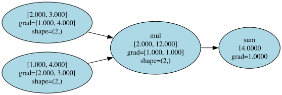
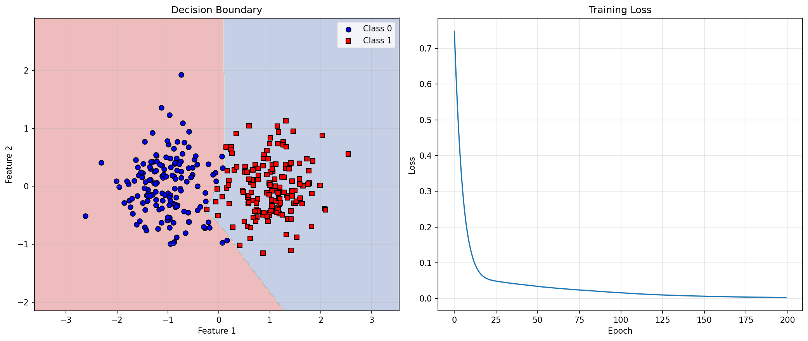
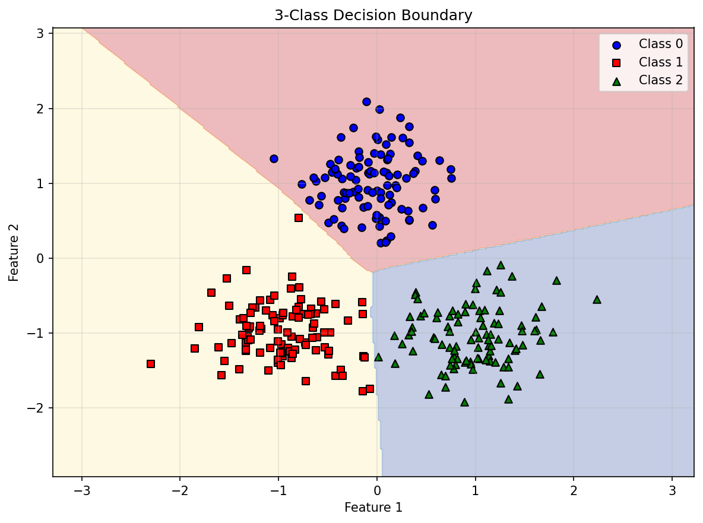

# BeaconGrad

NumPy autograd and a neural-network library with a PyTorch-style API.
BeaconGrad builds a computation graph from tensor operations and propagates
gradients through it using reverse-mode automatic differentiation.

## What is included

- N-dimensional tensors, broadcasting-aware arithmetic, matrix multiplication,
  reductions, activations, and losses.
- Layers and modules including linear layers, MLPs, attention, embeddings,
  dropout, and batch normalization.
- SGD, Adam, RMSprop, and AdaGrad optimizers.
- Finite-difference gradient checks, PyTorch comparisons, and graph visualization.

This is an implementation for studying autodiff. NumPy operations are not
optimized for large-scale training.

## Installation

Use Python 3.9 or later and [uv](https://docs.astral.sh/uv/):

```sh
git clone https://github.com/stochi0/beacongrad.git
cd beacongrad
uv sync --locked
```

For an editable package installation, run `uv pip install -e .` after syncing.

## A first gradient

```python
from beacongrad import Tensor

x = Tensor([2.0, 3.0], requires_grad=True)
loss = (x * x).sum()
loss.backward()

print(loss.item())  # 13.0
print(x.grad)      # [4. 6.]
```

For a complete training loop:

```sh
uv run python examples/02_neural_network.py
```

## Gradient and parity checks

Check derivatives against finite differences:

```sh
uv run python examples/08_gradcheck.py
```

Compare forward outputs and gradients against PyTorch for linear layers, an MLP,
and attention. PyTorch is an optional dependency for this comparison:

```sh
uv pip install torch
uv run python examples/compare_with_pytorch.py
```

The script reports maximum absolute output and gradient errors for its test
cases. These checks cover the included examples rather than the entire API.
The retained comparison plot can be regenerated with
`uv run python examples/10_parity_plot.py`.


## Examples and visualizations

The [examples directory](examples/) progresses from tensor operations to training,
attention, and gradient checks. Useful starting points:

| Example | What it shows |
| --- | --- |
| [Basic tensors](examples/01_basic_tensor.py) | Operations and backpropagation |
| [Custom modules](examples/04_custom_model.py) | Building a model with the module API |
| [Computation graphs](examples/06_visualize_graph.py) | Values, operations, shapes, and gradients |
| [Decision boundaries](examples/07_decision_boundary.py) | Binary and multiclass classification |
| [Attention](examples/09_attention.py) | Attention built from differentiable operations |

Graph rendering requires the system Graphviz executable as well as the included
Python `graphviz` dependency.



<details>
<summary>Retained classification examples</summary>





</details>

## Development and references

```sh
uv build
```

[micrograd](https://github.com/karpathy/micrograd) is a useful starting point for
scalar autodiff. BeaconGrad extends that learning exercise to tensor operations.
The unused mascot asset retains its [OpenMoji attribution](assets/ATTRIBUTION.md).
